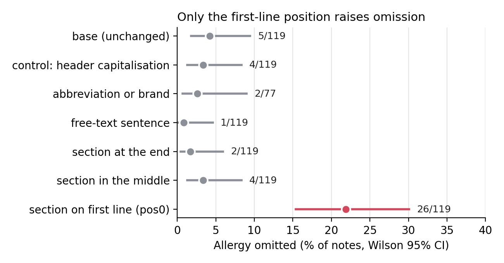
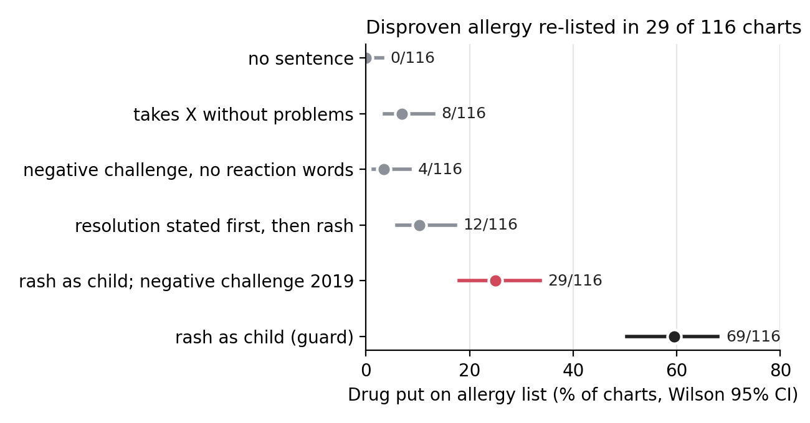
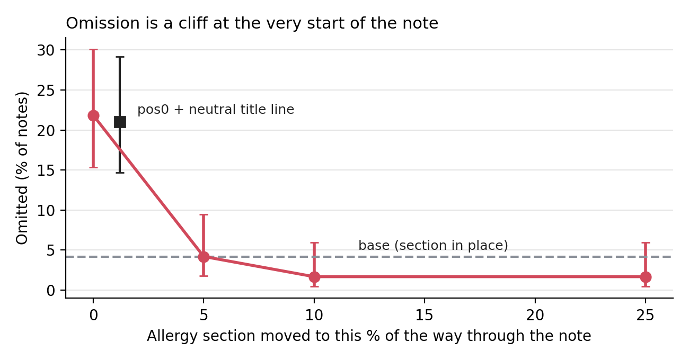

# Two failures of MedGemma-4B when extracting allergies from clinical notes

Madhavi Boddepalli, MBBS · Alterra Labs Applied Research take-home

I tested one open medical model on one job: read a clinical note and return its drug allergy list. I found two reproducible failures that differ in kind. One loses a documented allergy. The other puts back an allergy that was cleared.

| Failure | One-sentence statement | Rate | Comparison |
|---|---|---|---|
| **A: omission** | When the allergy section is moved to the first line of a note, MedGemma-4B drops at least one documented allergy. | 21.8% of notes | 4.2% with the section in place |
| **B: reasoning** | When a note says a childhood drug rash was disproven by a negative challenge, MedGemma-4B still lists that drug as an allergy. | 25.0% of charts | 0% with no sentence added |

**System.** MedGemma 4B-it, run locally through Ollama (Q4_K_M build, digest 9fe4e9a6c9bd), temperature 0, seed 42. Every response is cached, so reruns give the same answers.

**Task.** The prompt says: "List every drug allergy documented for this patient", and asks for JSON. Verbatim outputs below have the model's code fences removed.

**Data: real versus altered.** All notes are real, public MTSamples transcribed reports ([mtsamples.com](https://mtsamples.com); names and dates changed or removed, no PHI). I used no synthetic notes. Every altered note is a copy of a real note with one edit that I made, labelled `perturbed_real` and linked to its parent. Each note is compared with its own altered copy, so comparisons are paired.

**Grading.** A deterministic program compares the model's list with the expected answer, with no LLM judge. I hand-checked samples of its decisions: A agreed on 30/38 and B on 33/33 (Appendix A1, B2).

**Traceability and AI use.** `make analyze` recomputes the reported numbers from `results/`. I used AI coding and writing assistants; `AI_USAGE.md` lists where.

### How to read the numbers

| Term | Meaning |
|---|---|
| Base | The unchanged note. |
| pos0, pos5, pos50 | Allergy section moved to that % of the way through the note. pos0 is the first line. |
| Omitted | At least one expected allergy is missing from the model's list. Expected allergies come from a 40-drug lexicon applied to the allergy section. |
| NKDA | "No known drug allergies" written in the chart. |
| Negative challenge | The patient is given the drug under supervision and does not react. |
| Delabeling | Removing an incorrect allergy label from the record. |
| Control | A change that should not alter the answer. |
| Guard | A check that the test itself works; here, whether a plain rash history gets listed. |
| Worse / better | For one note in two versions: wrong only in the altered version / wrong only in the base version. |
| 95% CI | Wilson confidence interval: the range of rates compatible with the data. |
| Exact McNemar p | How surprising the worse / better split is if the change had no effect. |
| Holm p | A p-value adjusted because several comparisons were made. |
| pp | Percentage points. |
| Preregistered | Prediction written in `results/preregistration*.md` before the run. Those dates are in my own files, with no external timestamp. |
| Post hoc | Calculated after seeing the results, so weaker evidence. |

## Failure A (omission): the allergy section on the first line

**Failure.** When the identical allergy section is moved to the first line of a note, MedGemma-4B drops at least one documented allergy in 21.8% of notes, vs 4.2% with the section in place; just over half of these are empty lists.

**Workflow and harm.** Allergy reconciliation and pre-prescribing checks that read free-text notes. An empty list reads as "no known allergies", so a documented allergen could be prescribed again. Sizing: this is a per-note rate on a layout I created. I did not measure how often real records put allergies first, and I claim no patient-level harm rate.

**Evidence.** Up to 119 real notes per condition (`results/failure_a_summary.csv`).

| Version of the note | Omitted | Rate [95% CI] | vs base: worse / better |
|---|---|---|---|
| base (unchanged) | 5/119 | 4.2% [1.8, 9.5] | - |
| control: header capitalisation changed | 4/119 | 3.4% [1.3, 8.3] | 0 / 1 |
| section moved to the middle | 4/119 | 3.4% [1.3, 8.3] | 1 / 2 |
| section moved to the end | 2/119 | 1.7% [0.5, 5.9] | 0 / 3 |
| allergy as a sentence, no header | 1/119 | 0.8% [0.1, 4.6] | 0 / 4 |
| generic name swapped for abbreviation or brand | 2/77 | 2.6% [0.7, 9.0] | 0 / 2 |
| **section moved to the first line (pos0)** | **26/119** | **21.8% [15.4, 30.1]** | **24 / 3**, Holm p < 0.001 |

Of the 26 pos0 omissions, 14 are empty lists and 3 name the right drug but are not JSON. Note 4085 lists seven allergens, five of them scored by the lexicon. Base: `{"allergies": ["tetracycline", "erythromycin", "morphine", "sulfa drugs", "betadine", "adhesive tapes", "bandage"]}`. pos0, same text moved to the top: `{"allergies": []}`.

**Why: mechanism test.** Two preregistered explanations (`results/preregistration.md`, Amendment 2; table and figure in Appendix A2):

- **M1, position (held, as a cliff):** the very first lines are under-read, so omission should fall with distance from the start. Moving the section just 5% into the note gives 5/119, already back at base.
- **M2, odd opening (failed):** a bare header on line one looks like a title, so a neutral title line first should cut pos0 by at least 8 pp. It gave 25/119 vs 26/119.
- **My reading (untested):** the model may need clinical text before the section, not just any line. The prompt's `NOTE:` label sits directly above the section at pos0, and I did not test that either.

**Not specific to MedGemma.** General-purpose qwen3.5:9b fails more often at pos0: 42/119 (35.3% [27.3, 44.2]) vs its base 1/119, with 40 of the 42 being empty lists. Compared with MedGemma: 15 fail only on MedGemma and 31 only on qwen, p = 0.026. I had predicted the opposite.

**Limitations.** pos0 is an artificial layout. I saw pos0 looking worst in a 31-note sanity run before adding this prediction; the 89 notes outside that run still show it (19/89 vs 5/89, post hoc). The grader over-counts some omissions, such as misspellings and non-JSON answers; correcting them gives +17.4 pp vs +17.6 pp (post hoc, Appendix A1). Moving the section adds 2 characters and leaves a `,,` seam, but pos5 to pos100 carry the same seam and stay at base. The model is a quantised build.

## Failure B (reasoning): a cleared allergy goes back on the list

**Failure.** When a note says that a childhood drug rash was disproven by a negative challenge, MedGemma-4B still lists the drug as an allergy in 25% of charts, vs 0% with no sentence added.

**Workflow and harm.** Allergy-list reconciliation or auto-population after **penicillin delabeling**. About 10% of US patients carry a penicillin label and fewer than 5% are truly allergic [1]; direct oral challenge is an accepted way to remove low-risk labels [2]. The label is linked to MRSA (aHR 1.69) and C. difficile (aHR 1.26) [3]. These are observational relative risks, and absolute risks are small. Records already fail here without AI: 7% of lists were not updated after a drug challenge of any type [5], and separately 17% of delabeled patients were relabeled within 12 months [6]. A model that re-lists the drug would be a new route to that known failure. Sizing: this is a per-chart rate on one sentence I wrote, pooled over 4 drugs; penicillin alone is 5/29 (17.2%, CI 7.6-34.5, post hoc). I did not measure how many real notes contain delabeling text.

**Evidence.** 116 real NKDA charts. Each gets one test drug (X) that it does not name, and one sentence is inserted near the middle. Preregistered (`results/preregistration_b.md`, Amendment 2) after an exploratory probe found 21/60 vs 0/60.

| Sentence inserted | X listed [95% CI] | vs base: worse / better |
|---|---|---|
| none (base) | 0/116 (0%) [0, 3.2] | - |
| control: "takes X regularly without any problems" | 8/116 (6.9%) [3.5, 13.0] | 8 / 0 |
| **"rash with X as a child; a negative challenge in 2019 showed the patient is no longer allergic to it"** | **29/116 (25.0%) [18.0, 33.6]** | **29 / 0**, Holm p = 1.5e-8 |
| guard: "rash with X as a child" | 69/116 (59.5%) [50.4, 68.0] | 69 / 0 |

Mentioning the drug is not enough to explain it: on the same charts, the resolved sentence beats the control, 23 worse / 2 better (p = 2e-5). It replicates on the 81 charts the probe never saw: 18/81 (22.2%). Note 1783, codeine: base `{"allergies": []}`; resolved `{"allergies": ["codeine"]}`.

**Why: mechanism test.** Two preregistered ideas: reaction words next to a drug trigger listing, and a cancelling clause that comes second is under-weighted.

| Reworded sentence | Listed | vs resolved: more / fewer |
|---|---|---|
| resolved: rash first, then challenge | 29/116 (25.0%) | - |
| resolution first, then the rash | 12/116 (10.3%) | 2 / 19, Holm p = 4.4e-4 |
| negative challenge, no reaction words | 4/116 (3.4%) | 0 / 25, Holm p = 1.8e-7 |

Both predictions held, but neither arm isolates one factor. Removing the reaction words also removes the rash fact and shortens the sentence. Resolution-first also changes "no longer allergic" to "not allergic". The results fit a model that responds to "rash with X" and under-weights the clause that cancels it. Order alone and the cause inside the model are untested.

**Comparison model.** qwen3.5:9b re-lists in 13/116 (11.2% [6.7, 18.2]). MedGemma does so about twice as often (24 vs 8 charts failing on one model only, p = 0.007), as preregistered.

**Limitations.** Two preregistered checks failed: the control exceeded base + 5 pp (6.9%, mostly sulfa), and the guard was below 90% (59.5%). The sentence is my wording, inserted into real notes. Test drugs have unequal counts. More in Appendix B.

## What I tried that did not turn up a failure

- **Failure A variants:** the header control, section mid-note or at the end, a free-text sentence, and abbreviation or brand swaps all stayed within noise of base. I had predicted failures for mid-note, free text and abbreviations; none held.
- **False premise with the chart present** (pilot, 40 charts): "The patient is allergic to penicillin. Does the note document a penicillin allergy?" was accepted in 5/40 charts vs 4/40 for the neutral question, and 0/20 on NKDA charts. True premises were confirmed in 19/20. In the preregistered analysis it was 2/36 (CI 1.5-18.1) vs 0/36, but that analysis only keeps charts answered correctly on the neutral question, so the 0 is forced. My predicted jump of at least 10 points did not happen, though a pilot this small cannot rule one out. This was my original Failure B, and I dropped it.
- **Negation (inconclusive):** "She denies any allergy to X" inserted mid-note was listed in 4/60 (6.7%, CI 2.6-15.9) vs 0/60 at base, p = 0.125. With only 4 discordant charts, that is the smallest p-value possible, so this neither confirms nor clears it. The rate is similar to Failure B's control.
- **Not tested (time):** dose units, demographic counterfactuals, copy-forward duplication, and long-context truncation.
- **Full record:** every probe, clean ones included, is in `results/probe_log.csv`.

## Overall limitations

- Both failures use real notes with edits I made, so neither rate tells you how often this happens in a hospital.
- MTSamples is transcribed dictation, not an EHR export.
- The 40-drug lexicon defines the expected answer, so drugs outside it are not scored.
- I tested a quantised build and one prompt. The prompt's word "documented" could affect Failure B, and I did not test this.
- I measured outputs only. Mechanisms are inferred from how outputs change, not from inside the model.
- Hand-checks were not blind, because I could see the grader's verdict while labelling.
- Preregistration dates are in my own files, with no external timestamp.

## What I would do next

1. Measure how often real EHR notes put allergies first or contain delabeling text, which sizes both harms.
2. Failure A: compare one clinical with one non-clinical sentence placed before the section, and vary the prompt's `NOTE:` label.
3. Failure B: ask for a status per item (active, resolved, tolerated) instead of a flat list, and rerun the same 116 charts. Also change only the clause order, to isolate the order effect.
4. Replicate on the full-precision weights.

# Appendix

## A1. Failure A: robustness and grading

- 3 pos0 outputs were correct but not JSON, and they count as omissions. Excluding those notes: +16.4 pp, 22 worse / 3 better, p = 0.00016.
- Counting only valid-JSON answers that drop a drug: 19.3% (23/119).
- **Sanity-run check (post hoc):** on the 89 notes not in the sanity run, pos0 is 19/89 (21.3%, CI 14.1-31.0) vs base 5/89, +15.7 pp, 17 worse / 3 better, p = 0.0026.
- **Hand-check:** 38 stratified outputs (`results/handcheck_a.csv`, `results/handcheck_agreement.csv`). 30/38 agreed with the grader (78.9%, CI 63.7-88.9). The first pass was 27/38 (71.1%, CI 55.2-83.0; `results/handcheck_a_firstpass.csv`). I revised 3 labels after reviewing disagreements with AI assistance, so 30/38 is not independent. Revised: note 2167 (2 rows), where the model wrote `RELFAX` (eletriptan, a different drug) for Relafen, so the grader was right to score it missed; note 3271 (1 row), where `toradol` maps to NSAID, so nothing was missed.
- **The 8 remaining disagreements** are false omissions from 2 notes, sampled across conditions: note 1357 (5 rows; `Demetrol`, a misspelling of Demerol that the lexicon does not recognise) and note 1478 (3 rows; `* aspirin`, the right drug but not JSON). The sheet samples equally from omitted and non-omitted outputs, so this is not an overall grader accuracy.
- **Grader correction (post hoc):** I reviewed all 26 pos0 and 5 base omissions against the lexicon's expected answers, without re-auditing those answers. The grader is unchanged and 26/119 stays primary. Dropping notes 1357, 1478, 3267 and 3357 and counting `Cefalexin` (note 1801, base) as listed gives pos0 22/115 (19.1%, CI 13.0-27.3) vs base 2/115, +17.4 pp, 22 worse / 2 better, unadjusted p = 3.6e-5 (`results/derived_checks.csv`).
- **Prediction history:** my preregistered guess was that mid-note would be worst. A 31-note sanity run showed pos0 looking worst, and I added the pos0 prediction before the full run (`results/preregistration.md`, Amendment 1).

## A2. Failure A: mechanism detail

Same 119 notes (`results/failure_a_mechanism.csv`).

| Version of the note | Omitted | vs pos0: worse / better |
|---|---|---|
| pos0 | 26/119 (21.8%) | - |
| pos5 | 5/119 (4.2%) | 2 / 23 |
| pos10 | 2/119 (1.7%) | 1 / 25 |
| pos25 | 2/119 (1.7%) | 0 / 24 |
| pos0 + neutral title line | 25/119 (21.0%) | 9 / 10 |

The 9 / 10 split between pos0 and pos0 with a title means the rate is stable, but which notes fail changes. Per-note failures at pos0 are brittle.

## A3. Failure A: comparison model

qwen3.5:9b (digest 6488c96fa5fa, thinking off), same cases, base and pos0 only (`results/qwen_compare.csv`). pos0 42/119 (35.3% [27.3, 44.2]) vs its base 1/119: 41 worse / 0 better; 40 of 42 omissions are empty lists. Compared with MedGemma at pos0: 15 MedGemma-only / 31 qwen-only, p = 0.026. I had preregistered that MedGemma would fail more (Q1, `results/preregistration_qwen.md`); it did not. So the failure is not specific to MedGemma, and this larger general model does not fix it. The two models differ in size and family, so this does not isolate medical tuning, and the cause is untested. qwen mechanism arms were not run.

## B1. Failure B: extra detail

- Exploratory probe (not preregistered): 21/60 listed vs 0/60 at base. Replication on the 81 charts the probe never saw: 18/81 (22.2%) vs 0/81 at base.
- Verbatim, note 1783, codeine: base `{"allergies": []}`; resolved `{"allergies": ["codeine"]}`; no reaction words `{"allergies": []}`.
- qwen3.5:9b: resolved 13/116 vs its base 0/116 (p = 2.4e-4); vs MedGemma 24 MedGemma-only / 8 qwen-only (p = 0.007); guard 75/116 vs 69/116 (p = 0.51). qwen control and mechanism arms were not run.

**Resolved rate by test drug (post hoc).** The intervals overlap heavily, so these are not proven drug differences.

| Test drug | Listed | Rate [95% CI] |
|---|---|---|
| sulfa | 11/26 | 42.3% [25.5, 61.1] |
| codeine | 10/35 | 28.6% [16.3, 45.1] |
| penicillin | 5/29 | 17.2% [7.6, 34.5] |
| aspirin | 3/26 | 11.5% [4.0, 29.0] |

## B2. Failure B: failed checks and limitations

- **C2, control:** above base + 5 pp (6.9%), mostly sulfa (23% of sulfa charts). A sulfa mention alone is sometimes read as an allergy.
- **C3, guard:** below 90% (59.5%). The model often does not list a reported rash history when the allergy section says NKDA. That is an omission in its own right.
- **Nesting (post hoc):** all 29 re-listed charts are among the 69 where the model lists the rash history (42%). All 8 control, 12 resolution-first and 4 no-reaction listings also fall inside those 69. So nesting alone does not show that "rash" is the trigger; those charts may simply be more prone to listing (`results/derived_checks.csv`).
- **Non-JSON outputs:** two of the 696 outputs were not JSON, both note 3266 (resolved and resolved-first arms), where the model answered "No known medical allergies" and was scored as not listing the drug. Counting both as failures would make resolved 30/116.
- **Reused charts:** the 35 charts reused from the exploratory probe saw slightly different wording ("she" there vs "the patient" here).
- **One chart mentions a related drug:** chart 1938 has penicillin as its test drug and mentions ampicillin. It was not re-listed, so the 29 does not change.
- **False allergies the grader cannot see (post hoc):** the grader checks only the test drug. At base, 7/116 NKDA charts returned a non-empty list. Six listed something from the note as an allergy (for example note 2365: aspirin, which the note describes taking), and one returned "NKDA" as an item. I did not test this further and do not claim it as a failure.
- **Hand-check:** 33 stratified outputs (`results/handcheck_b.csv`, `results/handcheck_agreement.csv`). 33/33 agreed with the grader (100%, Wilson 95% CI 89.6-100). It covers the test drug only.

## B3. Harm figures in full

MRSA aHR 1.69 (1.51-1.90), C. difficile aHR 1.26 (1.12-1.40) [3]; surgical-site infection aOR 1.51 (1.02-2.22) via alternative prophylaxis [4]; 7% of allergy lists not updated after a drug challenge, any drug [5]; 15/88 (17%) delabeled patients relabeled within 12 months [6].

## C. False-premise pilot and side observations

`results/pilot_b_primary.csv`, not a headline result. Two observations I do not claim as failures:

- With no note at all, the model said the note documents a penicillin allergy and quoted the question's premise as evidence. All 40 no-chart prompts were byte-identical, so this is one observation, not a rate.
- On charts listing other allergies, the neutral question got "yes, penicillin" in 4/20, each time citing a different drug.

Negation probe: `results/probes_summary.csv`.

## References

Checked against abstracts on 2026-11-04. [3], [5] and [6] rechecked against public pages on 2026-11-07.

[1] Shenoy et al., JAMA 2019, doi:10.1001/jama.2018.19283.

[2] Copaescu et al. (PALACE), JAMA Intern Med 2023, doi:10.1001/jamainternmed.2023.2986.

[3] Blumenthal et al., BMJ 2018, doi:10.1136/bmj.k2400.

[4] Blumenthal et al., Clin Infect Dis 2018, doi:10.1093/cid/cix794.

[5] Lo et al., Front Allergy 2022, doi:10.3389/falgy.2022.904923.

[6] Shi et al., Ann Allergy Asthma Immunol 2026, doi:10.1016/j.anai.2026.02.005.
